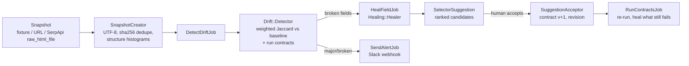

# ParserGuard

**Detects when search-engine result pages change layout, tells you which parser fields broke, and suggests replacement CSS selectors.**

Scraping APIs live and die by parsers that read someone else's HTML. When Google renames `yuRUbf` to `kb0PBd`, extraction drops to zero and customers notice before you do. ParserGuard watches captured SERP HTML, measures structural drift against a known-good baseline, runs your parser contracts, and when a field breaks it finds where the old values moved and proposes ranked selectors for a human to accept.

Built with Ruby 3.3, Rails 8, MongoDB (Mongoid 9), Sidekiq, Nokogiri, Stimulus.

```
$ bin/rails parserguard:demo
google en-US/desktop v2    minor   score=0.225 broken=
google en-US/desktop v3    broken  score=0.349 broken=title,link,snippet
google en-US/desktop v4    broken  score=0.886 broken=_container
google en-US/desktop v5    broken  score=0.956 broken=_container

$ bin/rails parserguard:regression
ok   google   class_rename.html        healed_rate        expected >= 0.9   got 1.0
ok   google   structural_change.html   healed_rate        expected >= 0.9   got 1.0
...
18 checks, 0 failed
```

## How it works



1. **Contracts** (`config/contracts/*.yml`): a container selector plus per-field selectors, required flags and types (`string`, `url`, `integer`). Extraction rate = valid required cells / (containers × required fields).
2. **Drift**: every snapshot stores histograms of root-to-node tag paths (`div>div>a>h3`) and class paths (`div.g>div.yuRUbf>a>h3.LC20lb`). Drift = 0.6 × tag drift + 0.4 × class drift, each `1 − weighted Jaccard`. Severity also reflects whether contracts still pass, so an ad block above the results is `minor`, not a page.
3. **Healing**: take known-good values from the baseline's last passing run, find them in the new DOM (exact, then banded Levenshtein ≥ 0.85; URLs by host+path), generate selectors from those nodes (ids, ARIA/data attributes, semantic tags, readable vs build-generated classes, short chains, `nth-of-type`), and score each across the whole page:

   `confidence = 0.4·coverage + 0.3·agreement + 0.2·stability + 0.1·uniqueness`

   If the container itself is gone, it climbs from the matched values to the item boundary and scores container candidates by the extraction rate the contract would get. Suggestions are **never auto-applied**.

Details and formulas: [docs/ALGORITHMS.md](docs/ALGORITHMS.md).

## Quick start (Windows)

Prerequisites: Ruby 3.3 (RubyInstaller + DevKit), MongoDB 7+ running on `localhost:27017`. Redis is only needed for Sidekiq.

```powershell
cd parser_guard
bundle install
$env:JOB_ADAPTER = "async"          # in-process jobs, no Redis needed
bin/rails db:mongoid:create_indexes
bin/rails parserguard:demo          # loads contracts, imports fixtures, detects, heals
bin/rails server                    # http://localhost:3000
```

macOS/Linux: `docker compose up -d` starts MongoDB and Redis, then the same commands (drop `JOB_ADAPTER` to use Sidekiq: `bundle exec sidekiq`).

Environment (see `.env.example`):

| Variable | Purpose |
|---|---|
| `MONGODB_URI` | Mongo connection (default local) |
| `REDIS_URL`, `JOB_ADAPTER` | Sidekiq, or `async` for dev without Redis |
| `SERPAPI_KEY` | optional: real SERP HTML via SerpApi `raw_html_file` |
| `PARSERGUARD_WEBHOOK_URL` | optional: Slack-compatible alert webhook |
| `DASHBOARD_PASSWORD` | required outside development/test |

## Dashboard

- **Overview**: health card per engine/locale/device, latest contract runs, recent drift.
- **Drift timeline**: severity filter, per-event added/removed class paths, broken fields.
- **Suggestion review**: baseline values on the left, each candidate's coverage/agreement/stability/uniqueness and sample values on the right; Accept applies it, bumps the contract version and queues a re-run, which heals the next broken field (container first, then fields inside it).
- **Contracts**: field rates, run history, revision history (`div.g → div.MjjYud`).

## API

Create a key once (the raw token is shown only now; only its SHA-256 is stored):

```powershell
bin/rails parserguard:api_key NAME=ci
```

```bash
H="X-Api-Key: pg_..."
curl -H "$H" -H "Content-Type: application/json" -d '{"engine":"google","url":"https://example.com/serp.html"}' localhost:3000/api/v1/snapshots
curl -H "$H" "localhost:3000/api/v1/drift_events?severity=major,broken"
curl -H "$H" -X POST -d '{"field":"title","snapshot_id":"..."}' -H "Content-Type: application/json" localhost:3000/api/v1/contracts/<id>/heal
curl -H "$H" -X POST localhost:3000/api/v1/suggestions/<id>/accept
```

| Method | Path | Notes |
|---|---|---|
| GET/POST | `/api/v1/snapshots` | POST takes `html` or `url` (SSRF-guarded); `?include=html` on show |
| GET/POST/PATCH | `/api/v1/contracts` | PATCH validates before writing; selector changes bump `version` |
| POST | `/api/v1/contracts/:id/runs` | `snapshot_id` |
| POST | `/api/v1/contracts/:id/heal` | `field` (or `_container`), `snapshot_id` |
| GET | `/api/v1/runs`, `/api/v1/drift_events` | filters, `page`/`per` (≤100) |
| POST | `/api/v1/suggestions/:id/accept` / `reject` | 409 if already decided |

Errors are always `{"error":{"code","message"}}`.

## Rake tasks

| Task | What it does |
|---|---|
| `parserguard:demo` | Full pipeline on the bundled fixtures |
| `parserguard:ingest_fixtures DIR=...` | Import a fixture directory (manifest order) |
| `parserguard:fetch URL=... \| QUERY=...` | One snapshot from a URL or SerpApi |
| `parserguard:load_contracts [FORCE=1]` | Load YAML contracts (never overwrites healed ones without FORCE) |
| `parserguard:run`, `parserguard:detect`, `parserguard:heal` | Run contracts / detect drift / suggest selectors |
| `parserguard:regression` | Manifest-driven regression suite in a scratch DB; exits 1 on failure (CI) |

## Testing

```powershell
bundle exec rspec                      # 203 examples, ~97% line coverage
bin/rails parserguard:regression       # 18 fixture expectations
bin/rubocop
```

Each test process uses its own MongoDB database (dropped afterwards), so parallel runs don't interfere. Fixtures in `spec/fixtures/serp/google/` cover: baseline, ads block added (minor), obfuscated classes rotated, structural change (container gone), consent interstitial (broken). Expectations live in `manifest.yml` and drive both the spec and the rake task.

## Security notes

Captured pages and URLs are untrusted input. Measures in place:

- **SSRF**: http/https only. Every address the host resolves to must be public, and the IPv6 forms that reach IPv4 or internal space are blocked. The connection is pinned to the vetted IP, so DNS rebinding can't swap the address. Each redirect hop is re-checked.
- **Response limits**: streamed byte cap, identity encoding (no gzip bombs), total deadline.
- **Healing**: banded Levenshtein with work budgets; parse depth capped at 128.
- **Selectors**: a policy rejects universal-descendant chains, nested `:has`, and over-long selectors.
- **Rendering**: everything is escaped and CSP uses script nonces. Slack mrkdwn is escaped.
- **Auth**: API keys are stored hashed. Dashboard basic auth fails closed outside dev/test.

What was found and fixed during hardening: [docs/HARDENING.md](docs/HARDENING.md).

## Project layout

```
app/services/ingestion   snapshot creator, URL/SerpApi/fixture fetchers
app/services/html        normalizer, encoding, structure signature
app/services/contracts   loader, runner, extractor, type validator, selector policy
app/services/drift       comparator (math), detector (orchestration)
app/services/healing     text matcher, selector generator, scorer, healer, acceptor
app/services/regression  manifest-driven regression runner
app/jobs                 detect -> heal -> alert pipeline, scheduled ingest
app/controllers/api/v1   JSON API
docs/                    plan, algorithms, hardening notes
```

## Known limitations

- Container healing needs at least two matched results; a page with exactly one result yields no container suggestion.
- Drift histograms cover the whole `<body>`; very dynamic pages may need a narrower scope per engine.
- Sidekiq does not support Windows natively. On Windows use `JOB_ADAPTER=async`, or run Sidekiq under WSL or Docker.
