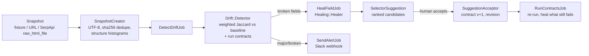

# ParserGuard

ParserGuard notices when a search results page changes its HTML, tells you which parser fields stopped extracting, and suggests CSS selectors to replace the broken ones.

Any scraper that reads Google results depends on class names it doesn't control. When `yuRUbf` becomes `kb0PBd` overnight, extraction drops to zero, and usually a customer reports it first. ParserGuard compares each new capture of a results page with a known-good baseline, runs your parser contracts against it, and when a field breaks, finds where the old values went in the new page and ranks selectors that would pick them up again. A person reviews the suggestions and accepts one; nothing changes on its own.

Stack: Ruby 3.3, Rails 8, MongoDB with Mongoid 9, Sidekiq, Nokogiri, Stimulus.

```
$ bin/rails parserguard:demo
google en-US/desktop v2    minor   score=0.225 broken=
google en-US/desktop v3    broken  score=0.349 broken=title,link,snippet
google en-US/desktop v4    broken  score=0.886 broken=_container
google en-US/desktop v5    broken  score=0.956 broken=_container

$ bin/rails parserguard:regression
ok   google   class_rename.html        healed_rate        expected >= 0.9   got 1.0
ok   google   structural_change.html   healed_rate        expected >= 0.9   got 1.0
...
18 checks, 0 failed
```

## How it works



A contract (`config/contracts/*.yml`) says what to extract: a container selector for each result, and inside it a selector, a required flag and a type (`string`, `url` or `integer`) for each field. The extraction rate is the share of required cells that come out valid, i.e. valid required cells / (containers × required fields).

Every snapshot stores two histograms of root-to-node paths, one with tags only (`div>div>a>h3`) and one with classes (`div.g>div.yuRUbf>a>h3.LC20lb`). Drift is `0.6 × tag drift + 0.4 × class drift`, where each part is `1 − weighted Jaccard` against the baseline. Severity also looks at whether the contracts still pass. An ad block inserted above the results changes the structure, but as long as every field still extracts, it is logged as `minor` and nobody gets paged.

When a field breaks, the healer takes the values the field returned on the baseline and looks for them in the new page: exact text first, then banded Levenshtein at 0.85 similarity or higher, and host plus path for URLs. From each node it finds, it builds candidate selectors (ids, ARIA and data attributes, semantic tags, readable classes ranked above build-generated ones, short parent chains, `nth-of-type`) and scores every candidate across the whole page:

```
confidence = 0.4·coverage + 0.3·agreement + 0.2·stability + 0.1·uniqueness
```

If the container selector itself matches nothing, the healer climbs from the found values to the boundary of each result item and scores container candidates by the extraction rate the contract would get with them. The full formulas are in [docs/ALGORITHMS.md](docs/ALGORITHMS.md).

## Running it locally

You need Ruby 3.3 (on Windows, RubyInstaller with the DevKit) and MongoDB 7 or newer on `localhost:27017`. Redis is only needed if you want Sidekiq.

```powershell
git clone https://github.com/Shiivu13/parserguard.git
cd parserguard
bundle install
$env:JOB_ADAPTER = "async"          # run jobs in-process, no Redis
bin/rails db:mongoid:create_indexes
bin/rails parserguard:demo          # loads contracts, imports fixtures, detects drift, heals
bin/rails server                    # http://localhost:3000
```

On macOS or Linux, `docker compose up -d` starts MongoDB and Redis. The commands are the same; leave out `JOB_ADAPTER` and start `bundle exec sidekiq` to use Sidekiq. Sidekiq doesn't run natively on Windows, so there use `JOB_ADAPTER=async`, WSL or Docker.

Configuration comes from environment variables (`.env.example` has all of them):

| Variable | Purpose |
|---|---|
| `MONGODB_URI` | Mongo connection, defaults to local |
| `REDIS_URL`, `JOB_ADAPTER` | Sidekiq, or `async` for development without Redis |
| `SERPAPI_KEY` | optional, fetch real result pages through SerpApi's `raw_html_file` |
| `PARSERGUARD_WEBHOOK_URL` | optional, Slack-compatible webhook for alerts |
| `DASHBOARD_PASSWORD` | required outside development and test |

## Dashboard

The overview starts with the suggestions waiting for a decision. Below them is a card per engine, locale and device, with the latest drift score and a small chart of recent scores.

The drift timeline lists every comparison and can be filtered by severity. Each drift event shows which fields broke and which class paths appeared or disappeared.

A suggestion page puts what the old selector extracted on the baseline next to each candidate's scores and sample values. Accepting a candidate updates the contract, bumps its version and re-runs it on that snapshot. Anything that still fails gets its own suggestion, so a structural change is fixed in steps: the container first, then the fields inside it.

Each contract page has its field rates, recent runs and the history of selector changes (for example `div.g → div.MjjYud`).

## API

Create a key first. The token is printed once, and only its SHA-256 hash is stored.

```powershell
bin/rails parserguard:api_key NAME=ci
```

```bash
H="X-Api-Key: pg_..."
curl -H "$H" -H "Content-Type: application/json" -d '{"engine":"google","url":"https://example.com/serp.html"}' localhost:3000/api/v1/snapshots
curl -H "$H" "localhost:3000/api/v1/drift_events?severity=major,broken"
curl -H "$H" -X POST -d '{"field":"title","snapshot_id":"..."}' -H "Content-Type: application/json" localhost:3000/api/v1/contracts/<id>/heal
curl -H "$H" -X POST localhost:3000/api/v1/suggestions/<id>/accept
```

| Method | Path | Notes |
|---|---|---|
| GET/POST | `/api/v1/snapshots` | POST takes `html` or `url` (SSRF-guarded); `?include=html` on show |
| GET/POST/PATCH | `/api/v1/contracts` | PATCH validates before writing; selector changes bump `version` |
| POST | `/api/v1/contracts/:id/runs` | `snapshot_id` |
| POST | `/api/v1/contracts/:id/heal` | `field` (or `_container`), `snapshot_id` |
| GET | `/api/v1/runs`, `/api/v1/drift_events` | filters, `page`/`per` (max 100) |
| POST | `/api/v1/suggestions/:id/accept` / `reject` | 409 if already decided |

Errors always have the shape `{"error":{"code","message"}}`.

## Rake tasks

| Task | What it does |
|---|---|
| `parserguard:demo` | Runs the whole pipeline on the bundled fixtures |
| `parserguard:ingest_fixtures DIR=...` | Imports a fixture directory in manifest order |
| `parserguard:fetch URL=... \| QUERY=...` | Captures one snapshot from a URL or a SerpApi search |
| `parserguard:load_contracts [FORCE=1]` | Loads the YAML contracts; without FORCE it leaves existing (possibly healed) contracts alone |
| `parserguard:run`, `parserguard:detect`, `parserguard:heal` | Runs contracts, detects drift, suggests selectors |
| `parserguard:regression` | Runs the fixture manifest in a scratch database and exits 1 on any failure; CI uses it |

## Tests

```powershell
bundle exec rspec                      # 203 examples, about 97% line coverage
bin/rails parserguard:regression       # 18 fixture expectations
bin/rubocop
```

Each test process gets its own MongoDB database and drops it at the end, so parallel runs don't wipe each other's data.

The fixtures in `spec/fixtures/serp/google/` are hand-written pages:
- the baseline
- the same page with an ad block added
- rotated obfuscated class names
- a structural change that removes the old container
- a consent interstitial with no results

`manifest.yml` holds the expected rate, drift score, severity and healing result for each one. The regression spec and the rake task both read it.

## Security

Captured pages and submitted URLs are treated as untrusted.

URL fetching only allows http and https. Every address a host resolves to must be public, and the IPv6 forms that lead to IPv4 or internal space are blocked. The connection goes to the IP that was checked, so DNS rebinding can't swap it, and every redirect is checked again. Responses are streamed with a byte cap, requested without compression to rule out gzip bombs, and limited by a total deadline.

Healing uses banded Levenshtein with limits on how much work one page can cause. Parsing stops at a depth of 128. User-supplied selectors can't use universal descendant chains, nested `:has` or very long expressions.

Everything rendered in the dashboard is escaped, and the CSP only allows scripts with a per-request nonce. Slack messages are escaped too. API keys are stored hashed, and the dashboard refuses to run outside development and test without a password.

[docs/HARDENING.md](docs/HARDENING.md) lists the problems found and fixed while hardening the app.

## Project layout

```
app/services/ingestion   snapshot creator, URL/SerpApi/fixture fetchers
app/services/html        normalizer, encoding, structure signature
app/services/contracts   loader, runner, extractor, type validator, selector policy
app/services/drift       comparator (math), detector (orchestration)
app/services/healing     text matcher, selector generator, scorer, healer, acceptor
app/services/regression  manifest-driven regression runner
app/jobs                 detect -> heal -> alert pipeline, scheduled ingest
app/controllers/api/v1   JSON API
docs/                    plan, algorithms, hardening notes
```

## Known limitations

Container healing needs at least two matched results, so a page with exactly one result gets no container suggestion.

Drift histograms cover the whole `<body>`. Pages with a lot of dynamic content outside the results may need a narrower scope per engine.
